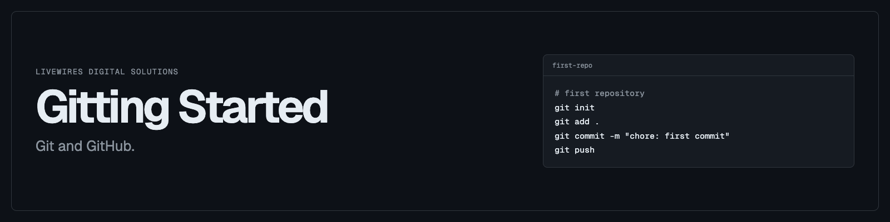

# Gitting Started

Exercise repo for the LiveWires Git and GitHub session.

Add one profile file to `people/`, push it to your fork, and open a pull request.

## Start here

- [EXERCISES.md](EXERCISES.md): labs, commands, and checkpoints
- [CHEATSHEET.md](CHEATSHEET.md): daily commands and fixes
- [LIVE.md](LIVE.md): updated during the session

## Rules

1. Only edit your own file in `people/`.
2. Never commit a password, token, or `.env` file.
3. Ask in chat when you are stuck.

Facilitator notes: [CURRICULUM.md](docs/CURRICULUM.md) and [FACILITATOR.md](docs/FACILITATOR.md).

Slides: <https://gitting-started.sam1.space>
